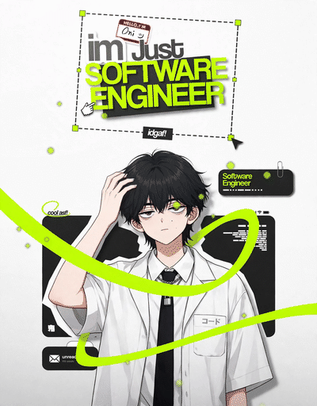

  

  

## 👨💻 About Me

<table>
  <tr>
    <td width="140" align="center">
      
    </td>
    <td>

I'm a **fresh graduate in Informatics Engineering** from Universitas Nahdlatul Ulama Cirebon, with an interest in **software development and technology**. 
Thesis defended, currently awaiting yudisium.

- 🎓 S1 Informatics Engineering, UNU Cirebon
- 💻 Exploring software development and modern technologies
- 🌱 Learning by building projects and experimenting with new ideas
- 🚀 Continuously improving my programming and problem-solving skills

    </td>
  </tr>
</table>

## 🛠️ Tech Stack

  

   

  
  
  

Exploring modern AI-assisted development and vibe coding workflows using Hermes, OpenCode, and 9Router.

## 📊 GitHub Stats

  
  

  

---

  

## 🚀 Featured Projects

<table>
  <tr>
    <td width="50%">
      
    </td>
    <td width="50%">
      
    </td>
  </tr>
  <tr>
    <td width="50%">
      
    </td>
    <td width="50%">
      
    </td>
  </tr>
</table>

  🔗 Live demos: [Bareskrim Recruitment](https://bareskrimrbx-recruitment.my.id/) • [ML Playground](https://ml.muhadilaga.my.id) • [Portfolio](https://portfolio.muhadilaga.my.id)

## 🎵 Spotify

## 📫 Connect With Me

  

  

  

  

I'm always open to learning, collaboration, and connecting with fellow developers.

Feel free to explore my repositories and follow my journey as I continue building and improving my skills.

---

━━━━━━━ ✦ ━━━━━━━━━━━ 
Thanks for visiting. 
See you in the next commit. 
━━━━━━━ ✦ ━━━━━━━━━━━

###
